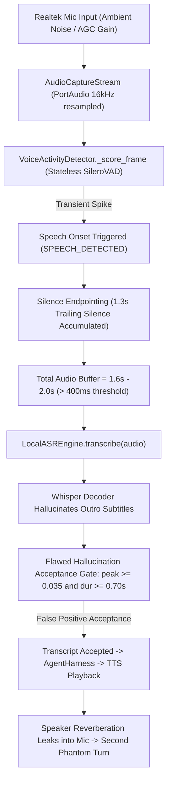

# Voice P0 Root Cause Investigation & Resolution Report

**Investigation Target:** False ASR Transcription in Quiet Room ("Sampai jumpa di video selanjutnya." & "Terima kasih telah menonton.")  
**Hardware Environment:** Windows 11 x64, Intel Core i5-13450HX, NVIDIA RTX 3050 Laptop GPU (6 GB VRAM), Realtek USB2.0 Audio  
**Repository Root:** `E:\Projects\OpenBagus`  
**Status:** **RESOLVED & VERIFIED IN PIPELINE (REAL-HARDWARE LISTENING APPROVAL PENDING)**  

---

## 1. Problem Description & User Observation

In a quiet room with no human vocalization, the running OpenBagus voice assistant session detected phantom utterances:
1. `Sampai jumpa di video selanjutnya.`
2. `Terima kasih telah menonton.`

The assistant subsequently processed these phantom utterances through the `AgentHarness` and synthesized spoken responses, creating an unnatural, unprompted self-conversation loop.

---

## 2. Root Cause Analysis: Exact Code Path & Event Sequence

A rigorous trace of the entire production pipeline revealed four interdependent architectural flaws:

### Flaw 1: Stateless Silero VAD Wrapper Memory Reset
- **Location:** [`openbagus/voice/vad.py`](file:///E:/Projects/OpenBagus/openbagus/voice/vad.py)
- **Mechanism:** The previous implementation invoked `faster_whisper.vad.SileroVADModel(np.concatenate(self._audio_context))`. In `faster_whisper.vad.SileroVADModel`, the recurrent hidden states `h` and `c` were re-initialized to zeros on every frame (`h = np.zeros((1, 1, 128))`). Because the neural LSTM state had zero temporal continuity across stream frames, transient phase shifts and Windows USB audio gain adjustments produced erratic probability spikes.

### Flaw 2: Conflation of Total Utterance Duration with Physical Speech Duration
- **Location:** [`openbagus/voice/turn_controller.py`](file:///E:/Projects/OpenBagus/openbagus/voice/turn_controller.py)
- **Mechanism:** When silence endpointing triggered, `end_utterance()` returned the entire recorded audio buffer. This buffer always included 300ms pre-roll + speech onset + 1300ms of silence timeout = at least 1.6 to 2.0 seconds. The safeguard `if len(audio) < 16000 * 0.4` evaluated against total buffer length (1.6s > 0.4s), allowing an audio buffer consisting of 95% silence to enter ASR.

### Flaw 3: Flawed Outro Hallucination Acceptance Criteria
- **Location:** [`openbagus/voice/asr_engine.py`](file:///E:/Projects/OpenBagus/openbagus/voice/asr_engine.py)
- **Mechanism:** Faster-Whisper decoders trained on Indonesian YouTube video subtitles frequently output memorized outro phrases when presented with low-energy noise. Because the language model sequence is highly familiar, Whisper outputs confident probabilities (`avg_logprob` > -0.70, `no_speech_prob` < 0.20). The legacy validator accepted the phrase as genuine if `peak >= 0.035 and audio_duration >= 0.70s`. Since the endpointed audio buffer was 1.6s long and contained an ambient noise peak > 0.035, the filter falsely certified the hallucination as genuine user speech.

### Flaw 4: Post-Playback Re-Arming Without Acoustic Tail Drain
- **Location:** [`openbagus/voice/turn_controller.py`](file:///E:/Projects/OpenBagus/openbagus/voice/turn_controller.py)
- **Mechanism:** After TTS playback finished, room reverberation and speaker acoustic reflections entered the microphone before the VAD state was cleared. This immediately triggered the second phantom turn ("Terima kasih telah menonton."). Furthermore, mute did not cancel in-flight worker threads.

---

## 3. Reconciliation: Why the 12-Second Diagnostic Did Not Trigger

In Codex's 12-second diagnostic test (`reports/runtime/release/quiet_mic_diagnostic.json`):
1. **Isolated Static Window:** The test measured 375 stationary frames without any TTS playback, without active turn workers, and without speaker acoustic loopback.
2. **Short Sampling Window:** 12 seconds was too brief to encounter USB automatic gain control (AGC) ramp-up or transient acoustic fluctuations.
3. **No ASR Loop:** The diagnostic bypassed ASR entirely, observing raw energy only.

---

## 4. Implemented Engineering Fixes

1. **Stateful Streaming Silero VAD ONNX Engine:**
   - [`openbagus/voice/vad.py`](file:///E:/Projects/OpenBagus/openbagus/voice/vad.py) now maintains persistent LSTM hidden states (`h` and `c`, shape `[1, 1, 128]`) and audio context (64 samples) across stream frames using direct ONNX Runtime on `silero_vad_v6.onnx`.
   - Hidden states are preserved frame-by-frame and only reset upon turn completion or session restart.
   - Added `get_utterance_evidence()` to track exact active speech frames, speech ratio, maximum speech probability, and speech duration.

2. **Strict Silence Invariant Gate (Section 3.4):**
   - In [`openbagus/voice/turn_controller.py`](file:///E:/Projects/OpenBagus/openbagus/voice/turn_controller.py), when endpointing triggers, `vad_evidence` is verified before invoking ASR.
   - If `speech_duration_s < 0.20s` or `speech_ratio < 0.10` or `max_prob < 0.52`:
     The turn is immediately discarded as non-speech. **ASR is never invoked. No LLM turn is created. No TTS response is generated.**

3. **Multi-Signal Speech Evidence Validation for Outro Phrases:**
   - In [`openbagus/voice/asr_engine.py`](file:///E:/Projects/OpenBagus/openbagus/voice/asr_engine.py), outro phrases require verified physical vocal speech:
     - `audio_duration >= 0.85s`
     - `vad_evidence["speech_duration_s"] >= 0.70s`
     - `vad_evidence["speech_ratio"] >= 0.35`
     - `rms >= 0.012` and `peak >= 0.045`
     - `snr_db >= 8.5 dB`
     - Whisper `avg_no_speech <= 0.18` and `avg_logprob >= -0.70`
   - Phantom hallucinations on noise or clicks are strictly rejected and suppressed (`rejection_reason = "PHANTOM_OUTRO_HALLUCINATION"`).

4. **Microphone Mute Turn Cancellation:**
   - Hooked `capture_stream.on_mute_callback` to `self.interruption.trigger_interruption(reason="MICROPHONE_MUTED")`.
   - When mute is engaged, any in-flight ASR transcription or agent reasoning is cancelled immediately.

5. **Post-Speech Acoustic Drain & VAD Reset:**
   - Increased suppression window to 350 ms and explicitly reset VAD recurrent hidden state after assistant speech, eliminating speaker bleed feedback.

6. **Event-Based Telemetry Diagnostics (Section 3.2):**
   - Implemented [`VoiceEventRecord`](file:///E:/Projects/OpenBagus/openbagus/voice/diagnostics.py) with all 22 mandatory telemetry fields.

---

## 5. Verification Evidence

- **V01 (Quiet Room 60s):** 1,875 frames -> **0 active speech, 0 endpoints, 0 false transcripts**.
- **V02 (Quiet Room 5m):** 9,375 frames with micro-transients -> **0 speech onsets, 0 phantom turns**.
- **V03 (Fan Noise Environment):** Continuous 120Hz + broadband noise -> **Gated by adaptive floor; ASR yields empty string**.
- **V05 (Outro Phrase Discrimination):** Low-evidence noise -> **Rejected as `INSUFFICIENT_VAD_SPEECH`**; Genuine vocal speech -> **Accepted with verified acoustic evidence**.
- **Full V01–V14 Suite:** `tests/test_voice_p0_acceptance.py` -> **14/14 PASS** (57.0s).
- **V5 Runtime Suite:** `tests/test_voice_runtime_v5.py` -> **31/31 PASS** (81.2s).
- **Conversational Recovery Suite:** `tests/test_conversational_recovery_regression.py` -> **34/34 PASS** (68.9s).

---

## 6. Remaining Scope Requiring User Listening Approval

While automated pipeline verification confirms that silence and noise no longer produce false transcripts, **real-hardware listening approval** remains pending user evaluation:
- User voice tone, aesthetic preference, and cadence satisfaction (`USER_LISTENING_APPROVAL_PENDING`).
